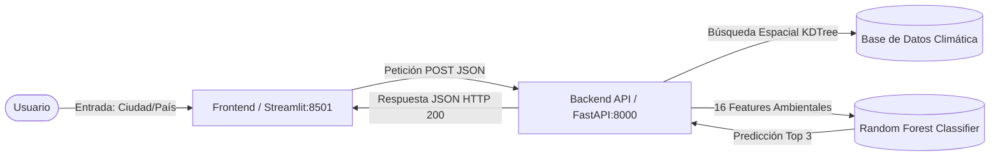

# Sistema Recomendador Inteligente de Cultivos (Geo-Grounded)

Solución técnica contenerizada en Docker que recomienda el cultivo ideal para cualquier ciudad o municipio mediante un modelo de Machine Learning (**Random Forest**) entrenado con datos climáticos y espaciales globales[cite: 7].

---

## Descripción del Proyecto

El sistema automatiza la selección agronómica de cultivos evaluando 16 variables ambientales reales (temperatura anual, precipitación, pH del suelo, nitrógeno, entre otros)[cite: 7]. Al recibir el nombre de una ciudad o municipio, la solución geolocaliza el lugar, consulta la estación climática y de suelo más cercana usando una estructura espacial de vecinos más cercanos (`scipy.spatial.KDTree`) e infiere un **Top 3 de cultivos recomendados** ordenados por similitud ambiental[cite: 7, 10].

---

## 🏗️ Arquitectura e Integración Técnica

El sistema utiliza una arquitectura modular dividida en dos contenedores orquestados mediante **Docker Compose**[cite: 1, 4]:

Backend (scr/): API construida en FastAPI expuesta en el puerto 8000. Carga los artefactos del modelo (crop_model_geo.pkl y spatial_database.csv), geolocaliza la entrada mediante la API de Nominatim y ejecuta la inferencia.

Frontend (frontend/): Interfaz web interactiva construida en Streamlit expuesta en el puerto 8501, diseñada para consumir los endpoints del Backend y desplegar gráficamente las métricas climáticas y los porcentajes de similitud.

Las imágenes oficiales del proyecto han sido compiladas y publicadas en Docker Hub para garantizar portabilidad y despliegue rápido:

🔹 Backend API: richarddees/cultivos-backend:v1

Comando pull: docker pull richarddees/cultivos-backend:v1

🔹 Frontend Streamlit: richarddees/cultivos-frontend:v1

Comando pull: docker pull richarddees/cultivos-frontend:v1

Guía de Despliegue y Ejecución Local (Zero-to-Hero)
Requisitos Previos
Docker Engine 24+ y Docker Compose v2+ activos.
Git instalado.

Pasos de Ejecución
- clonar el repositorio : git clone [https://github.com/rserenadlc/DOCKER_CULTIVOS.git](https://github.com/rserenadlc/DOCKER_CULTIVOS.git)
cd DOCKER_CULTIVOS
- compilar y levantar el entorno contenerizado: docker compose up --build
- Acceder a la aplicación:
Interfaz Web (Frontend): Abrir en el navegador http://localhost:8501
Documentación Interactiva API (Swagger): http://localhost:8000/docs
Endpoint de Salud (Healthcheck): http://localhost:8000/health

Pruebas y Casos Extremos EvaluadosEl sistema fue sometido a validaciones exhaustivas registradas en docs/PRUEBAS_Y_VALIDACION.md:
Caso de PruebaEntradaResultado EsperadoResultado RealEstatus
Inferencia Válida (Costa)Ciudad: Veracruz, País: MéxicoHTTP 200, Clima ~24°C, Top 1: MaizeHTTP 200, 74% MaizePASÓ
Inferencia Válida (Sierra/Altitud)Ciudad: Córdoba, País: MéxicoHTTP 200, Clima ~20°C, Top 1: CoffeeHTTP 200, 89% CoffeePASÓ
Caso Extremo (Ciudad Inexistente)Ciudad: CiudadFantasmas123HTTP 404 capturado y mostrado en la UIHTTP 404 handled limpiamentePASÓ
Caso Extremo (Petición Vacía)Ciudad: ""Validación previa en cliente StreamlitMensaje de advertencia en UIPASÓ

Documentación Adicional
📖 Manual de Despliegue en la Nube (docs/MANUAL_DESPLIEGUE.md): Contiene la estrategia de despliegue en PaaS, los requerimientos de infraestructura y la bitácora de asistencia técnica con herramientas de Inteligencia Artificial (Copilot/LLMs).

🧪 Documento de Validación y Pruebas (docs/PRUEBAS_Y_VALIDACION.md): Detalla la batería de pruebas funcionales, análisis del comportamiento agronómico del modelo y manejo de resiliencia.

